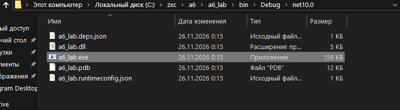
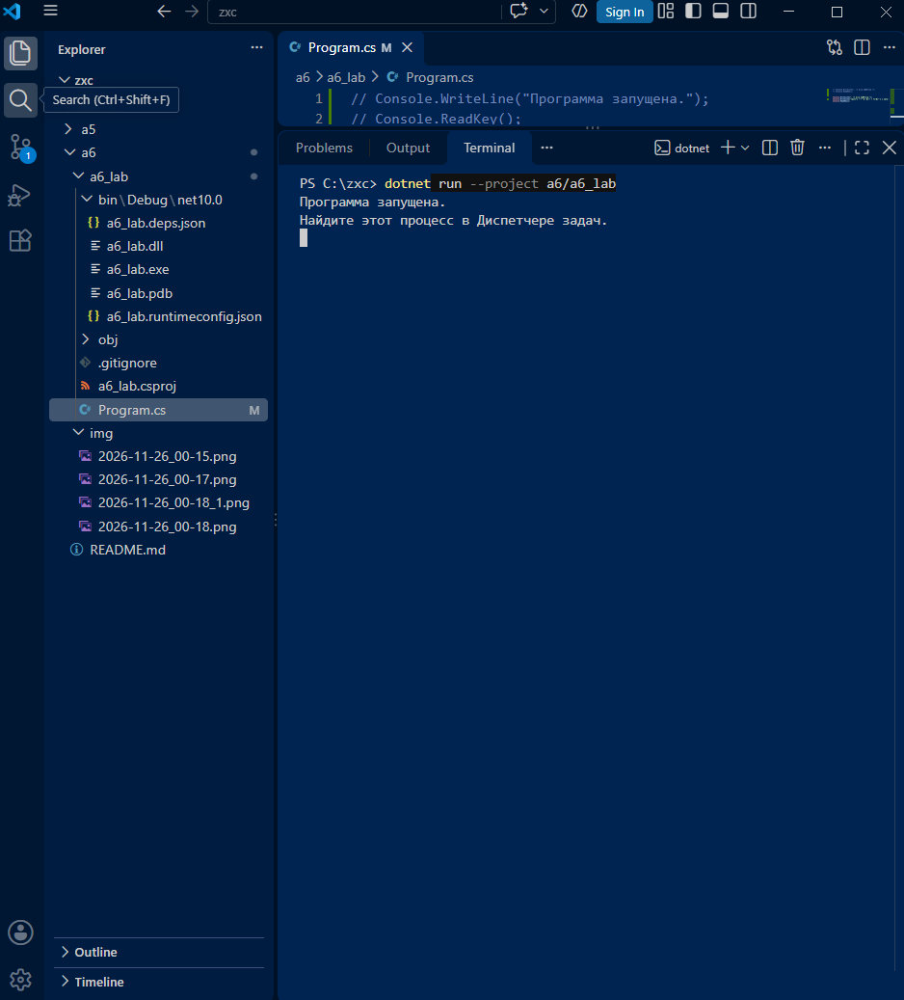
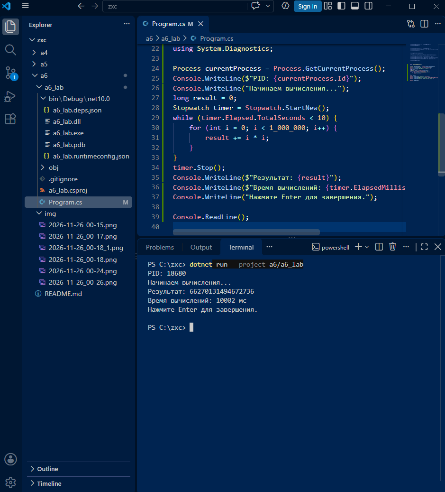

# Практическая работа №6

**Автор :** Тарасов Виктор
**Группа :** ИСП-255

## Шаг 2. Где находится программа до запуска

* **Путь к папке `bin`:** `C:\zxc\a6\a6_lab\bin\Debug\net10.0\`
* **Файлы в папке:**
  * `a6_lab.exe` — исполняемый файл программы (159 КБ)
  * `a6_lab.dll` — скомпилированная библиотека с кодом приложения (5 КБ)
  * `a6_lab.deps.json` — файл зависимостей проекта (1 КБ)
  * `a6_lab.runtimeconfig.json` — конфигурация среды выполнения .NET (1 КБ)
  * `a6_lab.pdb` — символы для отладки программы (12 КБ)

---

## Шаг 3–4. Поиск программы в Диспетчере задач и сравнение с процессом

* **Название процесса:** `a6_lab.exe` (дочерний процесс `dotnet.exe`)
* **PID (Ид процесса):** `7524` (при запуске на Шаге 5), `18680` (при запуске на Шаге 6)

**Вывод:** После нажатия клавиши и завершения работы программы процесс с указанным PID полностью исчезает из Диспетчера задач. Операционная система освобождает выделенную под него оперативную память, но сами файлы программы на диске остаются нетронутыми.

---

## Шаг 5. Память процесса

* **PID:** `7524`
* **Память по данным программы:** `17 МБ`
* **Память по данным Диспетчера задач:** `~15,4 МБ`

---

## Шаг 6 и Шаг 8. Нагрузка на процессор и накопитель

* **Тип накопителя:** NVMe SSD (модель: Kingston NV2 500GB)
* **Наблюдения за процессором:** До запуска нагрузка на ЦП была фоновой (около 4–7%). Во время 10-секундных вычислений (`Время вычислений: 10002 мс`, результат: `66270131494672736`) общая загрузка процессора выросла до ~18–22%, а одно из логических ядер загрузилось практически на 100%. После завершения цикла нагрузка вернулась к исходным значениям.

---

## Итоговый эксперимент

* **До запуска:**
  * Память: `7,8 / 15,8 ГБ (49%)`
  * Загрузка CPU: `5%`
* **Во время вычислений:**
  * Память: `7,9 / 15,8 ГБ (50%)`
  * Загрузка CPU: `21%`

**Ответ на главный вопрос:** После запуска операционная система загружает программу в оперативную память, чтобы процессор мог быстро обращаться к её инструкциям и переменным — поэтому растёт объём занятой RAM. Во время выполнения цикла процессор непрерывно выполняет миллионы арифметических операций в секунду, из-за чего резко увеличивается загрузка CPU.

---

## Итоговый вопрос

**Почему нельзя сказать: «Процессор запускает программу прямо с HDD/SSD»?**

Накопители (HDD и SSD) работают в тысячи раз медленнее процессора и оперативной памяти, поэтому процессор не считывает инструкции напрямую с диска. Вместо этого **операционная система** находит файл на накопителе, считывает его и загружает в быструю **оперативную память (RAM)**, создаёт процесс и выделяет ему ресурсы. Только после этого процессор начинает последовательно забирать машинные инструкции из RAM и выполнять их.

---

## Контрольные вопросы

1. **Чем файл программы на HDD/SSD отличается от работающего процесса?**
   Файл программы — это статичный набор данных и инструкций, который просто хранится на диске. Процесс — это активная, запущенная копия программы в оперативной памяти, которой управляет операционная система.
2. **Зачем программе нужна оперативная память после запуска?**
   RAM служит быстрым рабочим пространством: в ней хранится сам исполняемый код программы, её переменные, стек вызовов и промежуточные результаты вычислений, к которым процессор обращается на высокой скорости.
3. **Как по Диспетчеру задач можно увидеть, что программа действительно работает?**
   В списке процессов появляется запись с именем исполняемого файла (`a6_lab.exe`), уникальным идентификатором (`PID`), а также отображается потребляемая им оперативная память и процент нагрузки на процессор.
4. **Почему во время вычислений увеличивается загрузка CPU?**
   В коде запускается цикл, который в течение 10 секунд непрерывно нагружает ядро процессора миллионами математических операций умножения и сложения без пауз.
5. **Остаётся ли файл программы на HDD/SSD после завершения процесса?**
   Да, файл остаётся на накопителе без изменений, так как завершение процесса очищает только временную рабочую область в оперативной памяти.

### Скриншоты 

